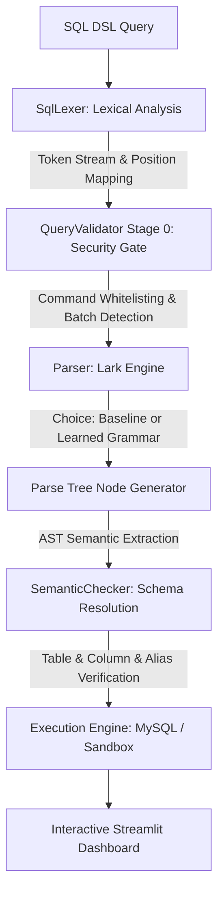

# AutoGrammar System Architecture

## 1. Overview
**AutoGrammar** is an end-to-end compiler and machine learning system that infers formal Domain-Specific Language (DSL) grammars from an exemplar corpus of SQL queries written for a relational school student management database (`school_db`).

Unlike conventional static SQL parsers or black-box classifiers, AutoGrammar implements a genuine rule induction engine that discovers syntactic productions, generalizes tokens, detects recurring clause patterns, builds executable Lark EBNF grammars, and performs 4-stage validation (Lexical, Syntax, Semantic, Security).

---

## 2. Component Pipeline

### 2.1 Lexical Analyzer (`compiler/lexer.py`)
- Employs deterministic regular expression specifications with strict precedence.
- Distinguishes SQL keywords, identifiers, string literals (`'...'`), numeric literals, comparison operators (`=`, `!=`, `<>`, `<=`, `>=`, `<`, `>`), and punctuation.
- Tracks exact 1-indexed `(line, column)` coordinates for error diagnostics.
- Categorizes unknown tokens as `TokenType.UNKNOWN` to halt invalid lexical streams immediately.

### 2.2 Grammar Induction Engine (`compiler/grammar_induction.py`)
- **Structural Pattern Mining**: Scans valid token streams to identify high-level statement skeletons (e.g., `SELECT->FROM->WHERE->ORDER_BY->LIMIT`).
- **Clause Generalization**: Generalizes specific column and table names into grammar nonterminals (`select_list`, `from_clause`, `where_clause`, `groupby_clause`, `having_clause`, `orderby_clause`, `limit_clause`, `join_clause`).
- **Precedence Hierarchy Induction**: Synthesizes boolean expressions with proper operator precedence (`OR` > `AND` > `NOT` > `predicates`).
- **EBNF Synthesis**: Dynamically outputs valid Lark EBNF syntax files (`grammars/learned.lark`).
- **Grammar Versioning**: Archives each approved grammar refinement into `grammars/versions/learned_<timestamp>.lark`.

### 2.3 Configurable Parser (`compiler/parser.py`)
- Dual-engine architecture supporting both the manually authored reference grammar (`baseline.lark`) and the inferred grammar (`learned.lark`).
- Uses Earley and LALR parsing algorithms capable of handling optionality, repetition, and recursion.
- Returns comprehensive parse trees and formatted ASCII hierarchical tree representations.

### 2.4 Semantic Validator (`compiler/semantic_checker.py`)
- Schema-aware relational validator for `school_db`.
- Validates entity existence: `students`, `teachers`, `classes`, `subjects`, `marks`, `attendance`.
- Resolves table aliases (`students AS s` -> verifies `s.first_name` belongs to `students`).
- Catches nonexistent columns and invalid cross-table references before query execution.

### 2.5 Security and Execution Guardrails (`compiler/query_validator.py`)
- **Stage 0 Pre-Parse Gate**: Blocks dangerous administrative SQL (`DROP`, `TRUNCATE`, `ALTER`, `GRANT`, `EXEC`).
- **Injection Prevention**: Blocks multi-statement command chaining (semicolon batching).
- **Unconstrained DML Protection**: Rejects destructive operations (`DELETE` or `UPDATE`) lacking specific `WHERE` clauses.

### 2.6 Relational Database Management (`database/connection.py`)
- Connects to MySQL 8.0+ when available.
- Features an automated fallback in-memory relational sandbox (SQLite) seeded with the exact synthetic Indian school dataset to ensure 100% testability across all platforms.
